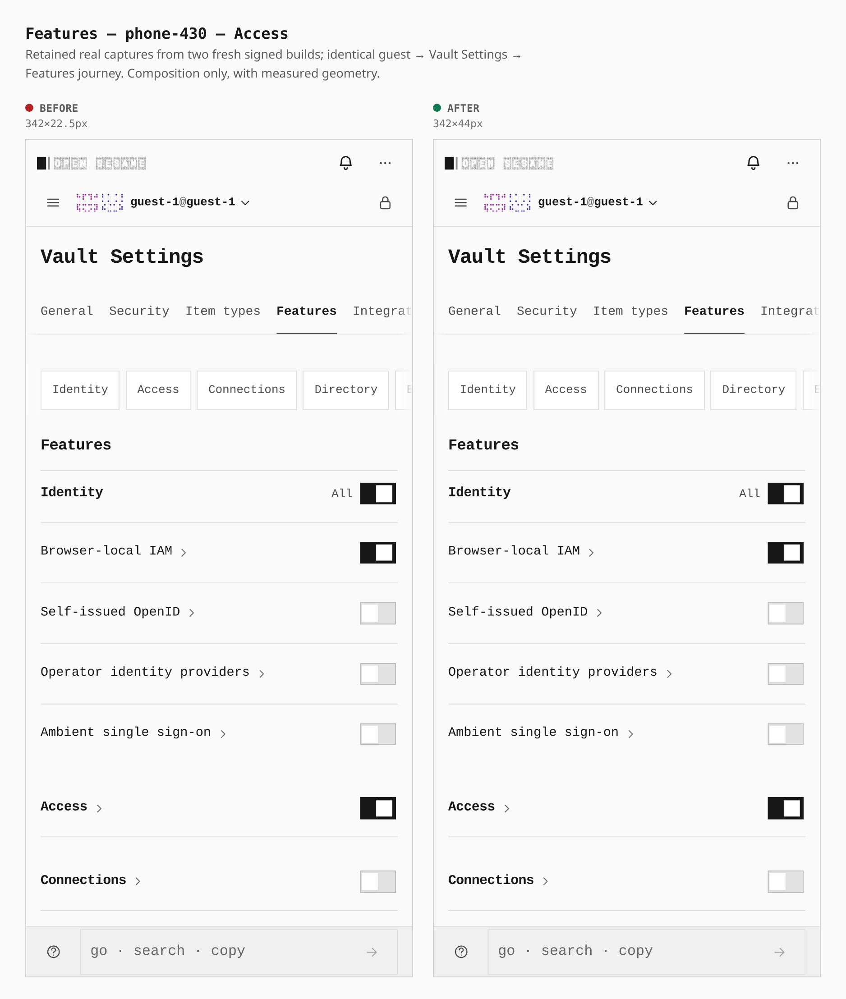
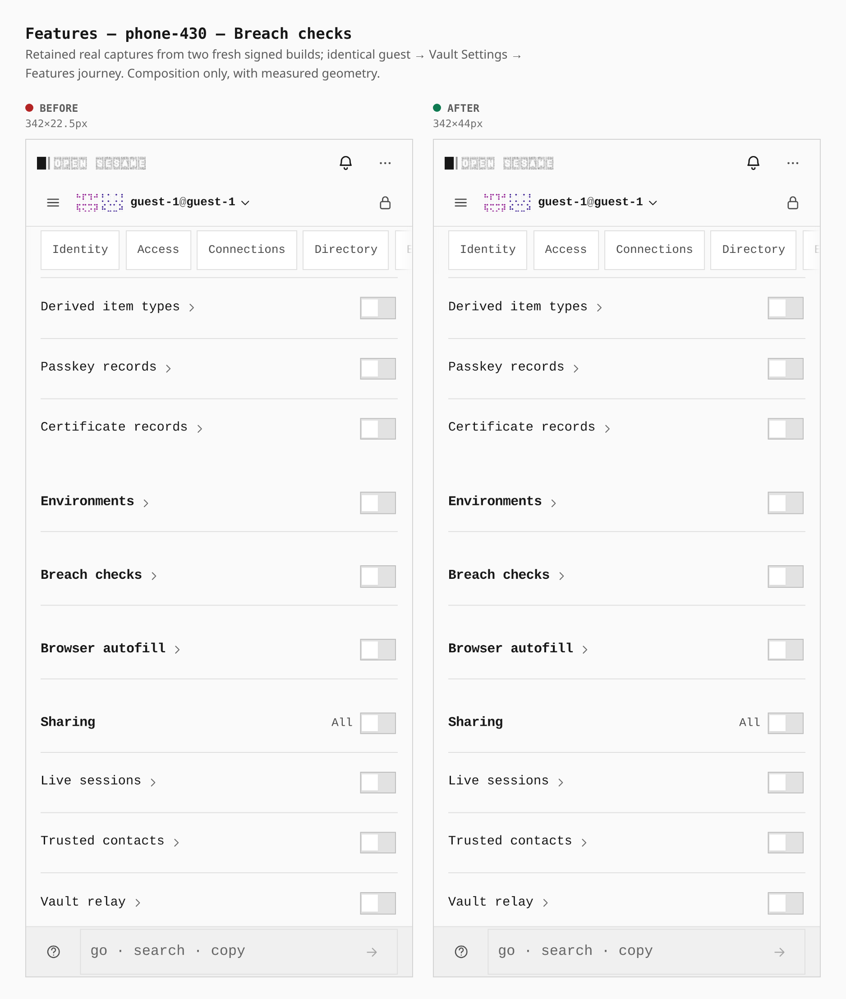
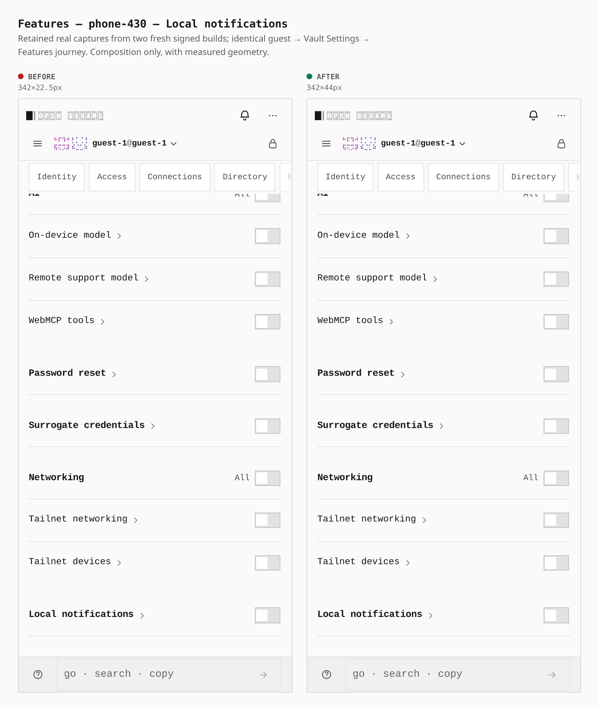
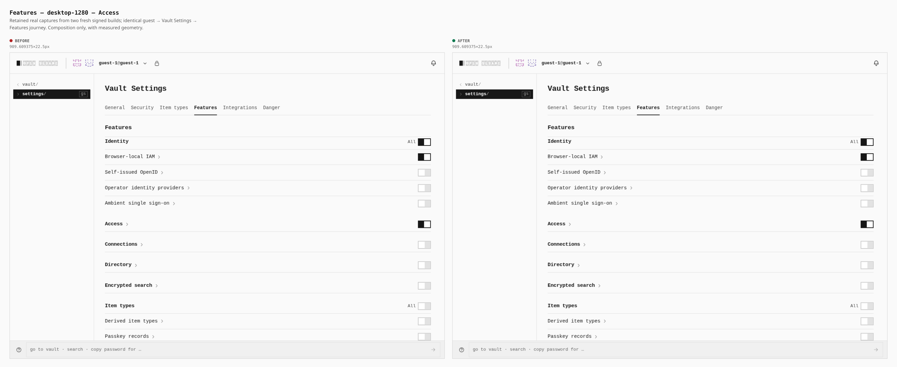
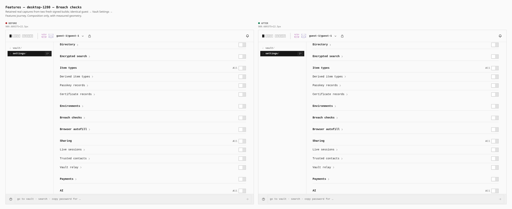
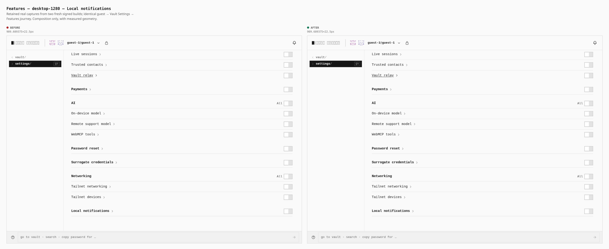

# Feature heading touch targets

Two real builds: before `8184dda8e23ec6a9316519933fbb03a231c9c0fc` and after CSS child `0946b272965ebeabe7e83de1e677014892410d0b`.

The recorded UI journey enters as guest, opens Vault Settings, then Features at 430px coarse and 1280px fine. All eleven title links were measured. Images below compose the retained uncropped real viewport screenshots; no PWA journey was repeated for composition.

| screen | before — width×height | after — width×height |
|---|---|---|
| phone-430 | 342×22.5px | 342×44px |
| desktop-1280 | 909.609375×22.5px | 909.609375×22.5px |

The original before capture passed. The original after capture remains failed: all recorded UI assertions and six raw screenshots completed, then the original gallery composer requested a hyphenated filename while harness.snap had written underscores. This separate result composes those retained actual images and does not reinterpret the failed receipt as a pass.

## phone-430 — Access

## phone-430 — Breach checks

## phone-430 — Local notifications

## desktop-1280 — Access

## desktop-1280 — Breach checks

## desktop-1280 — Local notifications

`journey.json`, `metrics.json` and `provenance.json` retain the recorded route, actual measurements, source/build/capture receipt hashes and both raw inventories. This gallery establishes the pictured UI geometry; no repeated PWA journey, canonical mobile acceptance, provider/native or physical-device proof is claimed.
