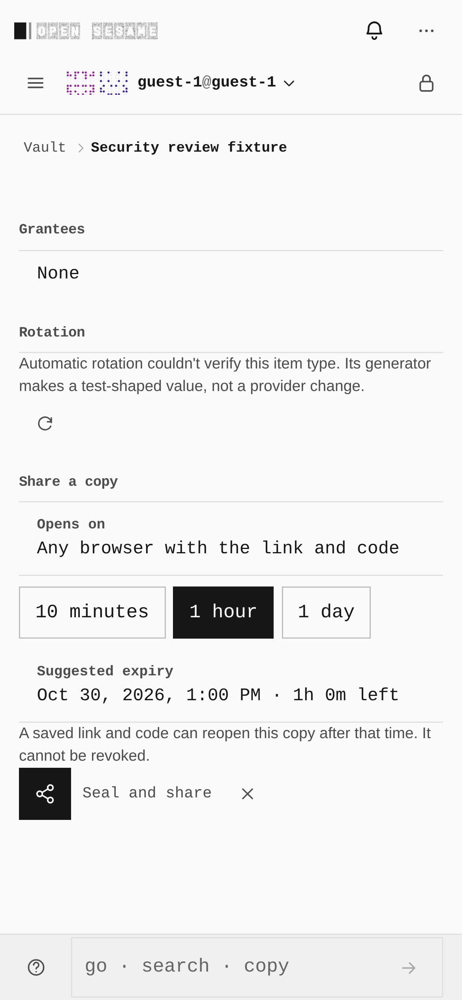
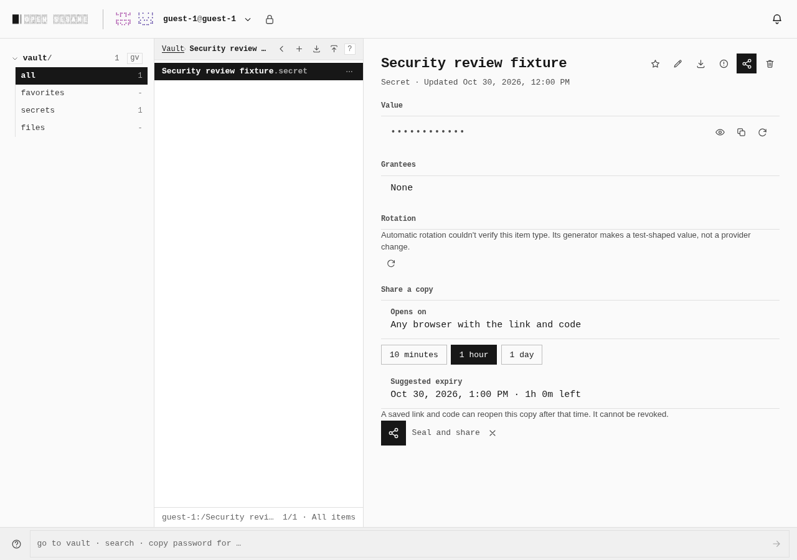
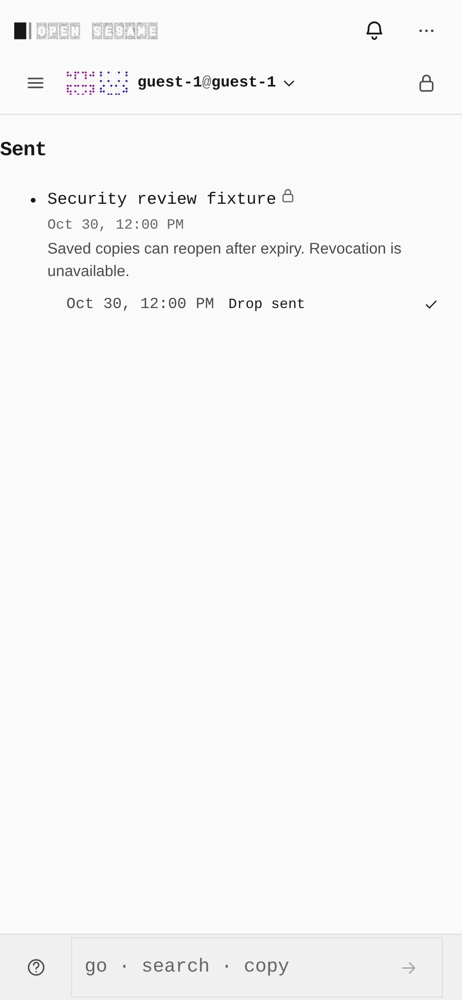
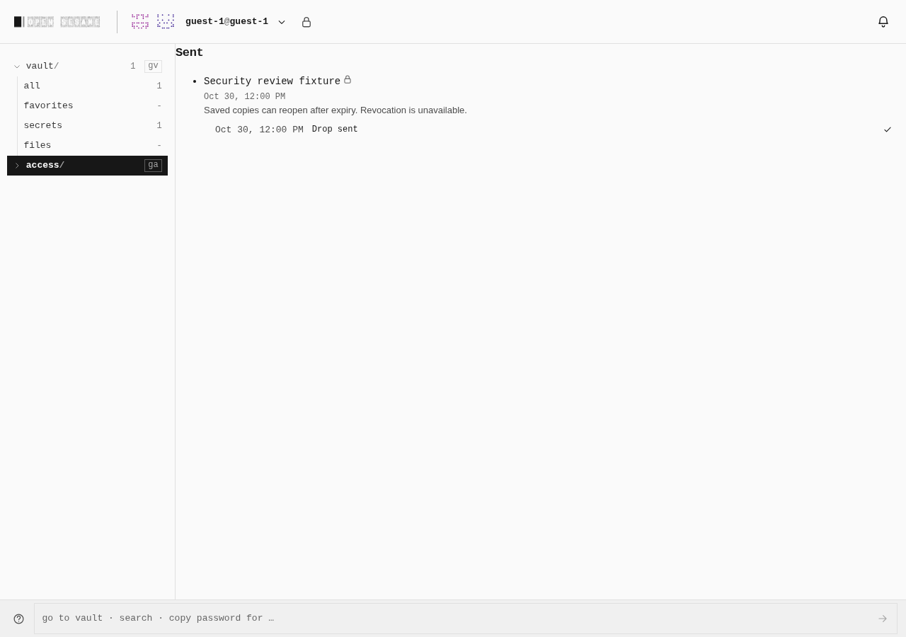
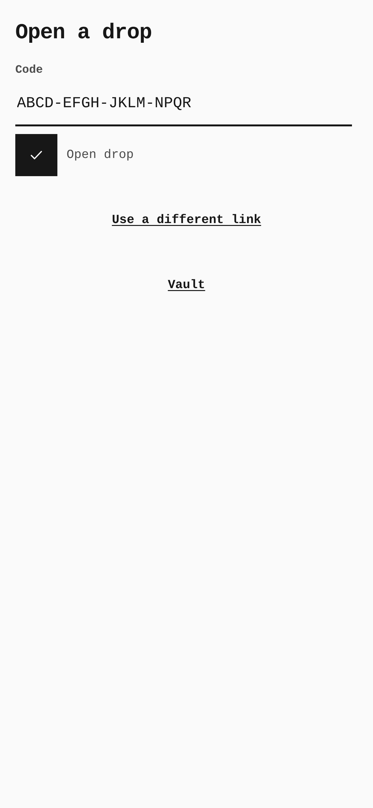
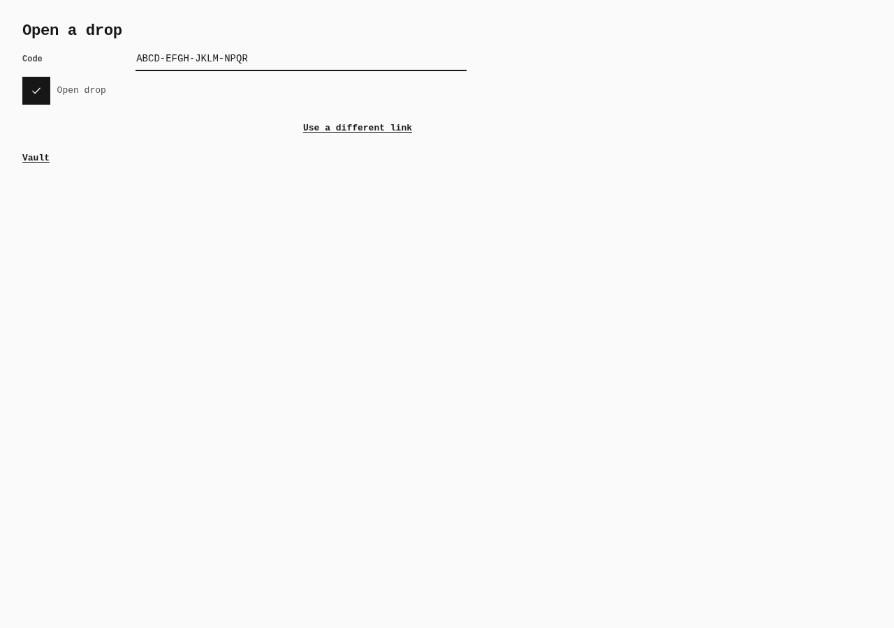

# Portable sharing on Pages

Current sharing controls disclose that a portable drop is a copy: its expiry is
suggested, saved links and codes can reopen it, and revocation is unavailable.
The receiver accepts the separate code in four groups; the Sent list omits an
unsupported Revoke control.

All captures use a disposable guest and the item `Security review fixture`.
The displayed receiver code is a deliberate synthetic fixture. This set contains
no personal data, live credentials, share URLs, or payload keys.

| State | Phone: 390 × 844 CSS pixels | Desktop: 1280 × 900 CSS pixels |
|---|---|---|
| Share form |  |  |
| Sent copy |  |  |
| Receiver code |  |  |

## Observed browser measurements

| Behavior | Phone | Desktop |
|---|---|---|
| Seal and share control | 44 × 44 px | 40 × 40 px |
| Keyboard activation | Tab/Enter; visible 2 px focus ring; control unobscured | Tab/Enter; visible 2 px focus ring; control unobscured |
| Lifecycle disclosure height | 38 px | 19 px |
| Sent row / disclosure height | 120 / 38 px | 100 / 19 px |
| Portable Sent status / Revoke controls | `Copy shared` accessibility label / zero | `Copy shared` accessibility label / zero |
| Receiver input / computed text | 352 × 44 px / 16 px | 474 × 32 px / 14 px |
| Receiver Vault navigation target | 358 × 44 px | Desktop text link; keyboard reachable |
| Receiver result | Four code groups fit; no sideways page scroll; fake payload opened with Enter | Four code groups fit; no sideways page scroll; fake payload opened with Enter |

The timestamp and lifecycle disclosure occupy separate lines in Sent. The
recipient address fragment is removed before code entry. The same lifecycle
warning also appears on the resulting drop card.

## Capture method and source

Implementation source:
`ee880c5054965ca748ba799d3fa557780783494f`.
Fresh captures came from the isolated shipping worktree, with the new main's
frozen dependencies, including Zod 4.6.6. The relevant committed client blobs
were compared with the worktree bytes; captures are not attributed to an
invented clean-HEAD build. The approval and file hashes are in the adjacent
`manifest.json` after promotion.

Publisher and receiver screenshots come from actual Vite HMR sessions using
the existing `minimal-local` capability profile with hardened selection. A
scratch adapter reused the repository capture journey verbs, forwarded requests
to the real loopback Vite server, blocked external traffic and service workers,
and supplied no authentication or Host API success mocks.

Sent screenshots come from a fresh real `enterprise-selected/hardened` build,
captured with `apps/pages/scripts/capture-evidence.mjs`. Its capability-graph
enforcement passed. This existing profile includes Access and explicitly omits
optional Tailscale. A separate fresh default Pages build, including native
Tailscale assets, also passed; the same Sent journey succeeded against that
default build.

Chromium 151.0.7922.173 on Linux; touch context at 390 × 844 and mouse context
at 1280 × 900. The synthetic clock was fixed to 2026-10-30 12:00 UTC. Images
are unmodified browser captures; phone images include the device scale factor.

The historical before captures use real builds at
`1afc79a678ce4aab4fcb8cb4777420fdf7ebdde7`: minimal-local/hardened for
publisher/receiver and enterprise-selected/hardened for Sent. Fresh after
captures retain those capability selections; publisher/receiver now run via
HMR, whereas Sent retains a built-profile comparison. Comparisons remain PR
review material outside this current-state slot.

## Verification limits

The unchanged default `verify:keyboard` gate exited 1 after 15 desktop contracts
passed. Its live-session contract failed waiting for `In a live session` on both
existing attempts; observed ICE candidate lists were empty. The later phone
portion was not reached. The passing sharing journeys above do not replace that
gate or certify live-session connectivity.

The receiver's prior 12.25 px text undercut the mobile 16 px no-zoom floor.
It now uses the existing field-font modifier: 16 px on coarse/narrow contexts,
14 px on desktop. The Vault return link also uses the existing navigation class
to reach a 44 px touch height. A focused audit at 320 and 390 px reported zero
canonical mobile-audit faults on arrival, with the code entered, and after
opening. At 1280 px, real Tab/Shift+Tab reached every receiver control and Enter
opened the fake payload. Fresh receiver screenshots were repeated after both
corrections; publisher and Sent source/rendering were unchanged.
The default Pages distribution was rebuilt with both corrections before the
unchanged canonical `verify:mobile` gate was started; its final result is
recorded with the PR checks.

Enterprise HMR was attempted but Vite rejected the existing imports of
`public/security-profile.json` and `public/static-auth/manifest.json` from
`src/host/shell-build.ts`; its error overlay blocked the Sent journey. No overlay,
check, or product source was changed to hide that failure. The matched built
profile supplies the Sent evidence instead. These Chromium runs verify the
16 px contract but do not certify every iOS release or hosted sharing.

Portable packets cannot enforce global one-use, revocation, expiry, or attempt
limits against a custom offline client. New codes contain 80 random bits and
protect the manifest cryptographically. Previously exposed `ospd1` links must
be recreated; patched clients cannot recover confidentiality of disclosed copies.
